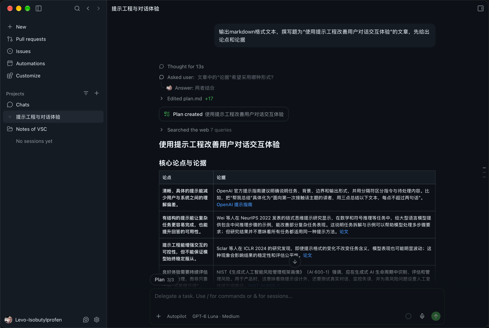

# 使用提示工程改善用户对话交互体验
学院：医药工程学院
班级：药学2602
姓名：才大为
学号：2650302101

## 核心论点与论据

| 论点 | 论据 |
|---|---|
| **清晰、具体的提示能减少用户与系统之间的理解偏差。** | OpenAI 官方提示指南建议明确说明任务、背景、边界和输出形式，并用分隔符区分指令与待处理内容。比如，把“帮我总结”具体化为“面向第一次接触该主题的读者，用三点总结以下文本，每点不超过两句话”。[OpenAI 提示指南](https://developers.openai.com/api/docs/guides/prompting) |
| **有结构的提示能让复杂任务更容易完成，也能提升回答的可用性。** | Wei 等人在 NeurIPS 2022 发表的链式思维提示研究显示，在数学和符号推理等任务中，给大型语言模型提供包含中间推理步骤的示例，能改善部分复杂任务表现。这说明任务拆解与示例可以帮助模型处理多步骤要求；但研究结果并不意味着所有任务都适用同一种提示方法。[论文](https://proceedings.neurips.cc/paper_files/paper/2022/file/9d5609613524ecf4f15af0f7b31abca4-Paper-Conference.pdf) |
| **提示工程能增强交互的可控性，但不能保证模型始终稳定服从。** | Sclar 等人在 ICLR 2024 的研究发现，即使提示格式的变化不改变任务含义，模型表现也可能明显波动；这种现象会影响结果的稳定性和评估公平性。[论文](https://openreview.net/forum?id=RIu5lyNXjT) |
| **良好体验需要持续评估和风险治理，而非只靠一条“完美提示词”。** | NIST《生成式人工智能风险管理框架画像》（AI 600-1）强调，应在生成式 AI 生命周期中识别、评估和管理风险。用于产品时，这意味着除提示设计外，还要测试真实对话、监控失误，并为高风险问题设置人工复核或升级路径。[NIST AI 600-1](https://doi.org/10.6028/NIST.AI.600-1) |

## 正文

提示工程不是寻找一句神奇咒语，而是把用户的目标、对话所需的背景和系统应遵守的边界，表达得更清楚，并通过测试不断改进。对话体验也不只取决于答案“看起来聪明不聪明”，还取决于用户是否容易表达需求、答案是否切题、出错时是否能纠正，以及系统是否坦诚说明能力边界。

### 一、说清楚任务，减少“答非所问”

用户常常只说“帮我改一下”“这个怎么处理”，但系统未必知道用户想要什么：是缩短篇幅、修正语气，还是检查事实？提示设计可以把关键目标明确化：任务是什么、面向谁、要处理哪些材料、有什么限制、希望以什么形式回答。输入内容较长时，把指令与材料分开，也能减少混淆。

例如，客服产品可以将“解释退款政策”设计为：“先根据以下政策回答用户的问题；用简明中文说明适用条件和所需步骤；如果政策没有覆盖该情况，明确说明并转交人工，不要自行承诺退款。”这类指令不一定让答案更华丽，却更可能使答案有用、边界清楚。

### 二、把复杂任务拆成用户看得懂的步骤

当用户需要比较方案、排查问题或完成多步骤操作时，一口气要求系统给出最终结论，容易遗漏信息。将交互组织为“确认目标—收集必要条件—分析选项—给出下一步”，可以让用户逐步补充背景，也便于发现误解。对格式要求严格的任务，还可以提供简短示例或固定输出结构，让结果更容易阅读和复用。

不过，步骤不应变成额外负担。简单问题无需强行拆解；若任务有缺失信息，系统应只询问影响答案的关键问题，而不是让用户填写冗长表单。提示工程改善体验的标准，不是提示词写得多复杂，而是用户能否更省力地得到正确帮助。

### 三、围绕多轮对话设计连续性与纠错

一次对话通常不是单轮问答。用户会补充条件、改变目标，或指出“这不是我想要的”。产品提示应引导系统在后续轮次中结合相关上下文，区分新要求与旧要求；当用户纠正答案时，应优先响应纠正，而不是重复原先的结论。对于可能过时或不完整的信息，系统也应说明不确定之处，并告诉用户需要哪些补充材料。

比如，写作助手可以先询问目标读者与语气，再按要求修改；用户说“保留原意，语气再自然一点”时，应只针对这项反馈迭代，而不是重新生成一篇风格完全不同的文本。这样的连续性来自明确的交互规则、适当的上下文管理和良好的反馈机制，不是单靠提示词就能无限记住所有内容。

### 四、用测试而非直觉改进提示

同一条提示在不同模型、不同输入和不同表达下，可能产生不同结果。研究中观察到的提示敏感性提醒我们：只挑一个看起来成功的例子，不足以证明设计可靠。团队可以建立一组代表性对话，覆盖常见需求、模糊提问、用户纠正和边界情况，并检查答案是否准确、是否遵守格式、是否在缺少依据时承认不确定，以及用户是否能顺利完成目标。提示变更后，用同一组案例对比结果，必要时再加入真实用户反馈。

对高风险场景，还要把提示之外的措施纳入设计：例如限制系统可执行的操作、检索可信资料、设置安全规则、提供人工接管渠道，并持续监控故障。提示可以引导模型，却不能替代权限控制、事实核验或专业判断。

### 结语

提示工程能改善用户对话体验，关键不在于堆砌术语，而在于把目标、背景、步骤、输出和边界设计清楚，并针对真实使用情况反复评估。清晰指令降低误解，合理拆解降低任务负担，连续反馈改善多轮协作；同时，提示敏感性和生成式 AI 的固有限制意味着，稳定可靠的体验还需要测试、技术保障与人工支持。把提示工程视为产品交互设计的一部分，而非万能补丁，才能让对话系统更有帮助，也更值得信任。

## 参考资料

1. OpenAI, [Prompting](https://developers.openai.com/api/docs/guides/prompting)（官方文档）。
2. Jason Wei et al., [Chain-of-Thought Prompting Elicits Reasoning in Large Language Models](https://proceedings.neurips.cc/paper_files/paper/2022/file/9d5609613524ecf4f15af0f7b31abca4-Paper-Conference.pdf), NeurIPS 2022。
3. Gabriel Sclar et al., [Quantifying Language Models’ Sensitivity to Spurious Features in Prompt Design](https://openreview.net/forum?id=RIu5lyNXjT), ICLR 2024。
4. NIST, [Artificial Intelligence Risk Management Framework: Generative Artificial Intelligence Profile (AI 600-1)](https://doi.org/10.6028/NIST.AI.600-1), 2024。

## 对话记录
